# 高等数学 A（一）专题 三角函数与反三角函数

## 写在前面

这份笔记把三角函数的两条线索并在一起：

- **正向**：角 $\to$ 函数值。六个三角函数由单位圆上的坐标定义，图像、定义域、值域都由这个定义决定。
- **反向**：函数值 $\to$ 角。三角函数是周期的，反解之前必须先截取一段单调区间，这就是反三角函数的由来。

全篇默认使用弧度制。最后一节回到单位圆，用有向线段把六个函数值直接画出来——这也是“正弦”“正切”“正割”这些名称的几何来源。

---

## 一、从直角三角形说起：锐角的六个比

设 $\triangle ABC$ 是直角三角形，$\angle C=\frac{\pi}{2}$，锐角 $\alpha=\angle A$。记 $\alpha$ 的对边 $a=BC$，邻边 $b=AC$，斜边 $c=AB$。

### 1.1 六个比

| 名称 | 记号 | 定义 | 读法 |
| --- | --- | --- | --- |
| 正弦 | $\sin\alpha$ | $\dfrac{a}{c}$ | 对边比斜边 |
| 余弦 | $\cos\alpha$ | $\dfrac{b}{c}$ | 邻边比斜边 |
| 正切 | $\tan\alpha$ | $\dfrac{a}{b}$ | 对边比邻边 |
| 余切 | $\cot\alpha$ | $\dfrac{b}{a}$ | 邻边比对边 |
| 正割 | $\sec\alpha$ | $\dfrac{c}{b}$ | 斜边比邻边 |
| 余割 | $\csc\alpha$ | $\dfrac{c}{a}$ | 斜边比对边 |

这些比值只与角 $\alpha$ 的大小有关，与三角形的大小无关：相似的直角三角形对应边成比例，六个比值完全相同。所以它们确实是 $\alpha$ 的函数。

### 1.2 三对倒数和“余”的含义

由定义立得三对倒数关系：

$$\sin\alpha\cdot\csc\alpha=1,\qquad \cos\alpha\cdot\sec\alpha=1,\qquad \tan\alpha\cdot\cot\alpha=1.$$

“余”字指余角 $\frac{\pi}{2}-\alpha$。在同一个直角三角形里，$\alpha$ 的对边恰好是 $\frac{\pi}{2}-\alpha$ 的邻边，$\alpha$ 的邻边恰好是 $\frac{\pi}{2}-\alpha$ 的对边，于是

$$\sin\left(\frac{\pi}{2}-\alpha\right)=\cos\alpha,\qquad \tan\left(\frac{\pi}{2}-\alpha\right)=\cot\alpha,\qquad \sec\left(\frac{\pi}{2}-\alpha\right)=\csc\alpha.$$

这就是“正弦/余弦”“正切/余切”“正割/余割”成对命名的原因。

### 1.3 直角三角形定义的局限

1. 只能处理锐角 $0<\alpha<\frac{\pi}{2}$；
2. 一切依赖“斜边”，而斜边只在直角三角形中存在，不能描述钝角或负角；
3. 当 $\alpha\to\frac{\pi}{2}$ 时邻边 $b\to0$，$\tan\alpha=\frac{a}{b}$ 与 $\sec\alpha=\frac{c}{b}$ 都失去意义。

要把定义推广到任意角，必须换一个不依赖三角形的载体——单位圆。

---

## 二、单位圆：任意角的六个函数

### 2.1 弧度制

在半径为 $r$ 的圆上，弧长等于 $r$ 的弧所对的圆心角称为 $1$ 弧度（rad）。由此

$$\text{圆心角的弧度数}=\frac{\text{弧长}}{\text{半径}},\qquad 180^\circ=\pi\ \text{rad}.$$

在单位圆（半径 $1$）上，圆心角的弧度数恰好等于它所对弧的弧长。以下所说的角都指弧度。

### 2.2 定义

在平面直角坐标系中作单位圆 $x^2+y^2=1$。把角 $\alpha$ 的顶点放在原点 $O$，始边与 $x$ 轴的非负半轴重合，设终边与单位圆交于点 $P(x,y)$，定义

$$\sin\alpha=y,\qquad \cos\alpha=x;$$

$$\tan\alpha=\frac{y}{x}\ (x\ne0),\qquad \cot\alpha=\frac{x}{y}\ (y\ne0);$$

$$\sec\alpha=\frac{1}{x}\ (x\ne0),\qquad \csc\alpha=\frac{1}{y}\ (y\ne0).$$

一句话：**余弦是终边与单位圆交点的横坐标，正弦是纵坐标**，其余四个由它们相除或取倒数得到。因此交点就是 $P(\cos\alpha,\sin\alpha)$。

### 2.3 与直角三角形定义的关系

设 $0<\alpha<\frac{\pi}{2}$，过 $P$ 作 $x$ 轴的垂线，垂足为 $M$。在直角三角形 $OMP$ 中，$OP=1$，$OM=\cos\alpha$，$MP=\sin\alpha$，于是

$$\sin\alpha=\frac{MP}{OP},\qquad \cos\alpha=\frac{OM}{OP},$$

与 1.1 中的“对边比斜边”“邻边比斜边”完全一致，只是把斜边归一化成了 $1$。同样，

$$\tan\alpha=\frac{MP}{OM},\qquad \sec\alpha=\frac{OP}{OM},\qquad \csc\alpha=\frac{OP}{MP},$$

也与 1.1 的定义一致。

所以：**直角三角形中的定义是单位圆定义在锐角情形的特例**。

### 2.4 三条直接推论

**(1) 终边相同的角，函数值相同。** 若两个角的终边重合，它们对应单位圆上同一个点 $P$，六个函数值完全相同。这说明六个三角函数都是周期函数（最小正周期见第四节）。

**(2) 坐标可正可负，函数值也可正可负。** 符号完全由 $P$ 所在的象限决定：

| 象限 | $x=\cos\alpha$ | $y=\sin\alpha$ | $\tan\alpha$ | $\cot\alpha$ | $\sec\alpha$ | $\csc\alpha$ |
| --- | --- | --- | --- | --- | --- | --- |
| 第一象限 | $+$ | $+$ | $+$ | $+$ | $+$ | $+$ |
| 第二象限 | $-$ | $+$ | $-$ | $-$ | $-$ | $+$ |
| 第三象限 | $-$ | $-$ | $+$ | $+$ | $-$ | $-$ |
| 第四象限 | $+$ | $-$ | $-$ | $-$ | $+$ | $-$ |

**(3) 单位圆方程给出一个恒等式。** 由 $x^2+y^2=1$ 立得

$$\sin^2\alpha+\cos^2\alpha=1,$$

它只是“点 $P$ 在单位圆上”的直接翻译。

### 2.5 定义域从分母读出

$\tan\alpha,\sec\alpha$ 的分母是 $x$，要求 $x\ne0$，即终边不落在 $y$ 轴上：

$$\alpha\ne\frac{\pi}{2}+k\pi\quad(k\in\mathbb{Z}).$$

$\cot\alpha,\csc\alpha$ 的分母是 $y$，要求 $y\ne0$，即终边不落在 $x$ 轴上：

$$\alpha\ne k\pi\quad(k\in\mathbb{Z}).$$

$\sin\alpha,\cos\alpha$ 没有分母，对一切实数有定义。

---

## 三、定义域与值域

### 3.1 总表

表中 $k\in\mathbb{Z}$。

| 函数 | 几何含义 | 定义域 | 值域 | 周期 | 奇偶性 |
| --- | --- | --- | --- | --- | --- |
| $y=\sin x$ | 交点纵坐标 | $\mathbb{R}$ | $[-1,1]$ | $2\pi$ | 奇 |
| $y=\cos x$ | 交点横坐标 | $\mathbb{R}$ | $[-1,1]$ | $2\pi$ | 偶 |
| $y=\tan x$ | $y/x$ | $\left\{x \mid x\ne\frac{\pi}{2}+k\pi\right\}$ | $\mathbb{R}$ | $\pi$ | 奇 |
| $y=\cot x$ | $x/y$ | $\left\{x \mid x\ne k\pi\right\}$ | $\mathbb{R}$ | $\pi$ | 奇 |
| $y=\sec x$ | $1/x$ | $\left\{x \mid x\ne\frac{\pi}{2}+k\pi\right\}$ | $(-\infty,-1]\cup[1,+\infty)$ | $2\pi$ | 偶 |
| $y=\csc x$ | $1/y$ | $\left\{x \mid x\ne k\pi\right\}$ | $(-\infty,-1]\cup[1,+\infty)$ | $2\pi$ | 奇 |

### 3.2 值域从何而来

- $[-1,1]$：$P$ 在单位圆上，所以 $|x|\le1$，$|y|\le1$；让 $\alpha$ 转一周，横、纵坐标都能取遍 $[-1,1]$。
- $\mathbb{R}$：$\tan\alpha=\frac{y}{x}$ 是终边的斜率，终边转动时斜率可取任意实数；$\cot\alpha$ 是斜率的倒数，再多补上斜率为 $0$ 时的值 $0$。
- $(-\infty,-1]\cup[1,+\infty)$：因为 $0<|x|\le1$、$0<|y|\le1$，所以 $\left|\frac{1}{x}\right|\ge1$、$\left|\frac{1}{y}\right|\ge1$。$\sec x$ 与 $\csc x$ 永远取不到 $(-1,1)$ 中的数，因此也没有零点。

### 3.3 特殊角的函数值

| $x$ | $0$ | $\frac{\pi}{6}$ | $\frac{\pi}{4}$ | $\frac{\pi}{3}$ | $\frac{\pi}{2}$ |
| --- | --- | --- | --- | --- | --- |
| $\sin x$ | $0$ | $\frac{1}{2}$ | $\frac{\sqrt2}{2}$ | $\frac{\sqrt3}{2}$ | $1$ |
| $\cos x$ | $1$ | $\frac{\sqrt3}{2}$ | $\frac{\sqrt2}{2}$ | $\frac{1}{2}$ | $0$ |
| $\tan x$ | $0$ | $\frac{\sqrt3}{3}$ | $1$ | $\sqrt3$ | 不存在 |
| $\cot x$ | 不存在 | $\sqrt3$ | $1$ | $\frac{\sqrt3}{3}$ | $0$ |
| $\sec x$ | $1$ | $\frac{2\sqrt3}{3}$ | $\sqrt2$ | $2$ | 不存在 |
| $\csc x$ | 不存在 | $2$ | $\sqrt2$ | $\frac{2\sqrt3}{3}$ | $1$ |

注意 $x=\frac{\pi}{2}$ 这一列：$\tan$ 与 $\sec$ 没有定义，而 $\cot=0$、$\csc=1$。“没有定义”与“等于无穷大”是两回事——函数在那里根本不存在，而不是取了一个很大的值。

---

## 四、六个三角函数的图像

下面六幅图的横轴都取 $[-2\pi,2\pi]$。图中的灰色虚线标出值域边界或渐近线。

### 4.1 正弦函数 $y=\sin x$

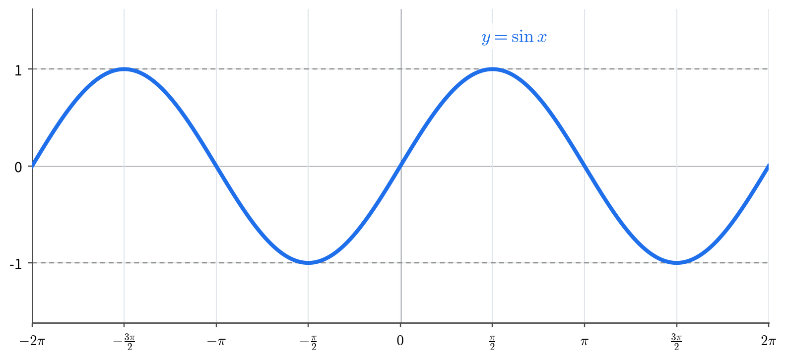

- 定义域 $\mathbb{R}$，值域 $[-1,1]$，图像夹在 $y=\pm1$ 之间。
- 周期 $2\pi$，奇函数，图像关于原点对称。
- 五个关键点 $(0,0)$、$\left(\frac{\pi}{2},1\right)$、$(\pi,0)$、$\left(\frac{3\pi}{2},-1\right)$、$(2\pi,0)$，每隔 $\frac{\pi}{2}$ 取一个，这就是“五点作图法”。
- 增区间 $\left[-\frac{\pi}{2}+2k\pi,\frac{\pi}{2}+2k\pi\right]$，减区间 $\left[\frac{\pi}{2}+2k\pi,\frac{3\pi}{2}+2k\pi\right]$。
- 零点 $x=k\pi$；最大值 $1$ 在 $x=\frac{\pi}{2}+2k\pi$ 处，最小值 $-1$ 在 $x=-\frac{\pi}{2}+2k\pi$ 处。

### 4.2 余弦函数 $y=\cos x$

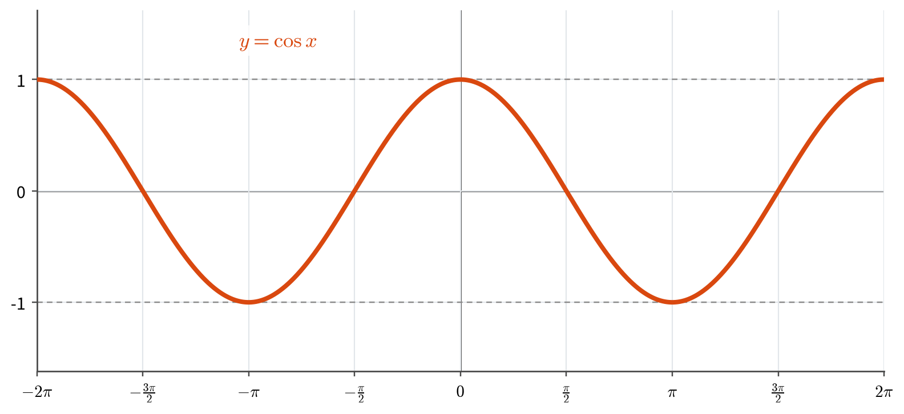

- 定义域 $\mathbb{R}$，值域 $[-1,1]$。
- 周期 $2\pi$，偶函数，图像关于 $y$ 轴对称。
- 五个关键点 $(0,1)$、$\left(\frac{\pi}{2},0\right)$、$(\pi,-1)$、$\left(\frac{3\pi}{2},0\right)$、$(2\pi,1)$。
- 减区间 $[2k\pi,(2k+1)\pi]$，增区间 $[(2k+1)\pi,(2k+2)\pi]$。
- 零点 $x=\frac{\pi}{2}+k\pi$；最大值 $1$ 在 $x=2k\pi$ 处，最小值 $-1$ 在 $x=(2k+1)\pi$ 处。
- 曲线形状与正弦曲线相同，只是左右平移了 $\frac{\pi}{2}$。

### 4.3 正切函数 $y=\tan x$

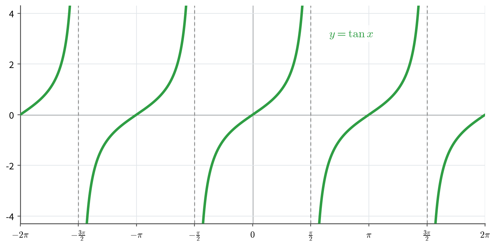

- 定义域 $\left\{x \mid x\ne\frac{\pi}{2}+k\pi\right\}$，每个断点处有竖直渐近线 $x=\frac{\pi}{2}+k\pi$。
- 值域 $\mathbb{R}$；周期 $\pi$；奇函数，图像关于原点对称。
- 在每一支 $\left(-\frac{\pi}{2}+k\pi,\frac{\pi}{2}+k\pi\right)$ 内单调增加。
- 零点 $x=k\pi$；每一支都经过点 $(k\pi,0)$。
- **注意**：只能说“在每一支上单调增加”，不能说“在定义域上单调增加”。例如 $\frac{\pi}{4}<\frac{3\pi}{4}$，但 $\tan\frac{\pi}{4}=1>-1=\tan\frac{3\pi}{4}$。

### 4.4 余切函数 $y=\cot x$

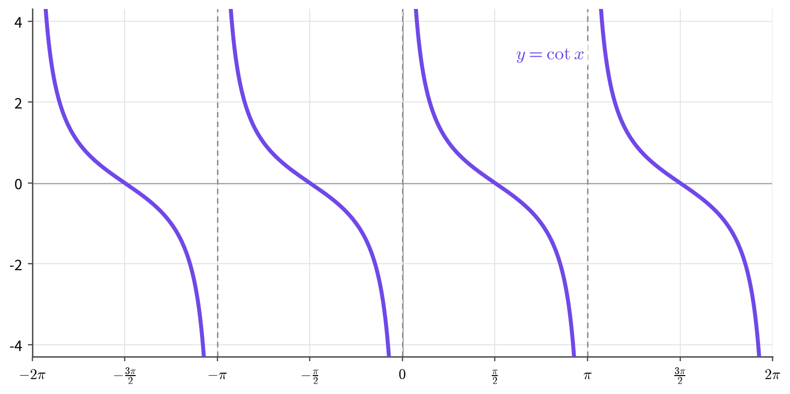

- 定义域 $\left\{x \mid x\ne k\pi\right\}$，渐近线 $x=k\pi$。
- 值域 $\mathbb{R}$；周期 $\pi$；奇函数。
- 在每一支 $(k\pi,(k+1)\pi)$ 内单调减少。
- 零点 $x=\frac{\pi}{2}+k\pi$。
- 每一支都从 $+\infty$ 单调降到 $-\infty$：在 $k\pi$ 右侧函数值很大，在 $(k+1)\pi$ 左侧函数值很小，中间恰好穿过零点 $\frac{\pi}{2}+k\pi$。

### 4.5 正割函数 $y=\sec x$

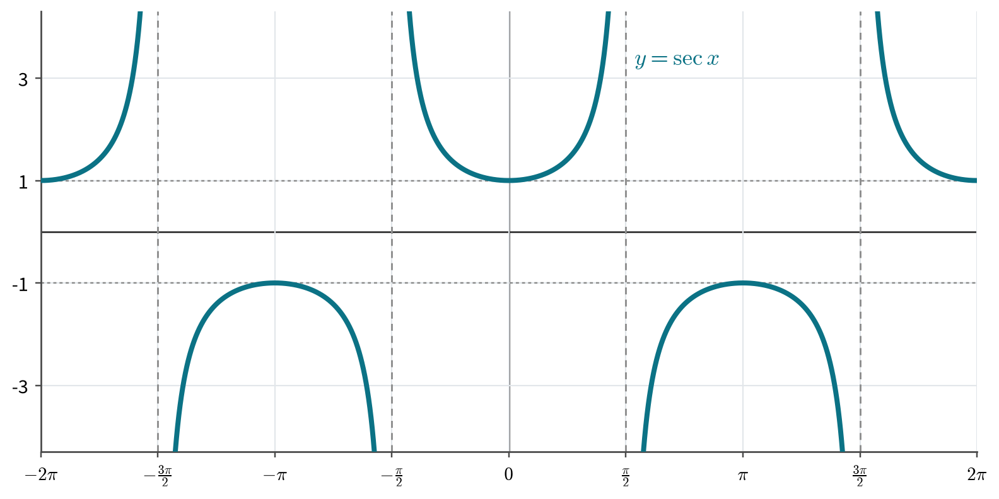

- 定义域 $\left\{x \mid x\ne\frac{\pi}{2}+k\pi\right\}$，渐近线 $x=\frac{\pi}{2}+k\pi$。
- 值域 $(-\infty,-1]\cup[1,+\infty)$；周期 $2\pi$；偶函数。
- 图像是一串“开口向上”或“开口向下”的 U 形曲线。它与 $y=\cos x$ 互为倒数：$\cos x$ 接近 $0$ 时 $\sec x$ 冲到很远，$\cos x=\pm1$ 时 $\sec x=\pm1$。
- 没有零点；在所有连续区间上与 $\cos x$ 的单调性相反。
- 在正支上，$x=2k\pi$ 时 $\sec x=1$ 是该支的最小值；在负支上，$x=(2k+1)\pi$ 时 $\sec x=-1$ 是该支的最大值。整体而言，$\sec x$ 既无最大值也无最小值。

### 4.6 余割函数 $y=\csc x$

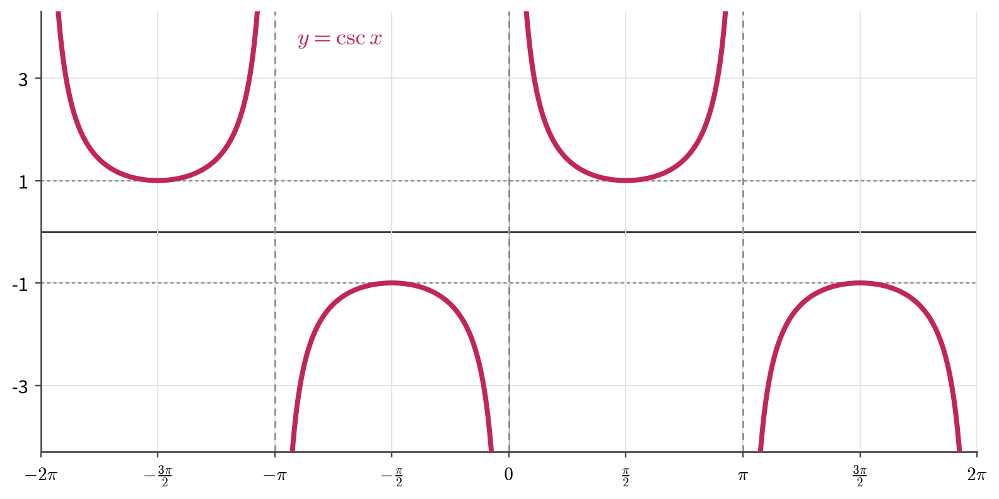

- 定义域 $\left\{x \mid x\ne k\pi\right\}$，渐近线 $x=k\pi$。
- 值域 $(-\infty,-1]\cup[1,+\infty)$；周期 $2\pi$；奇函数。
- 与 $y=\sin x$ 互为倒数，形状与正割曲线相同，只是左右平移了 $\frac{\pi}{2}$。
- 没有零点；在所有连续区间上与 $\sin x$ 的单调性相反。
- 在正支上，$x=\frac{\pi}{2}+2k\pi$ 时 $\csc x=1$；在负支上，$x=\frac{3\pi}{2}+2k\pi$ 时 $\csc x=-1$。整体既无最大值也无最小值。

### 4.7 六图并览与性质总表

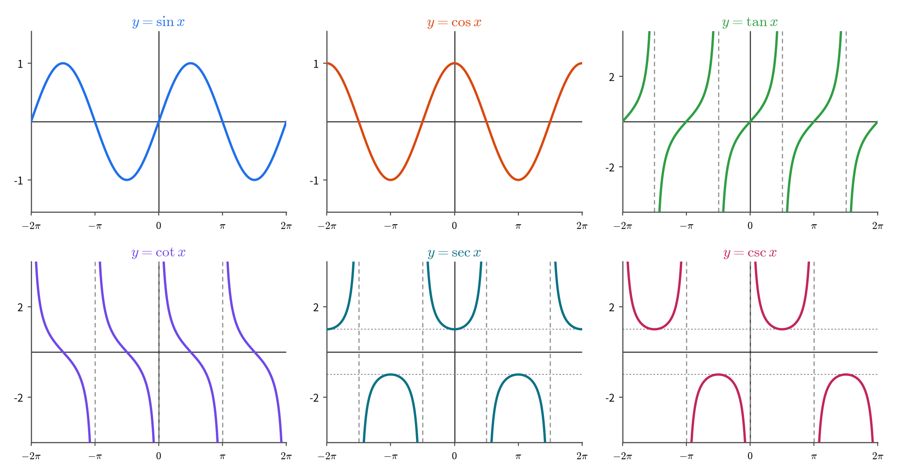

| 函数 | 零点 | 竖直渐近线 | 单调性 |
| --- | --- | --- | --- |
| $\sin x$ | $k\pi$ | 无 | 增 $\left[-\frac{\pi}{2}+2k\pi,\frac{\pi}{2}+2k\pi\right]$；减 $\left[\frac{\pi}{2}+2k\pi,\frac{3\pi}{2}+2k\pi\right]$ |
| $\cos x$ | $\frac{\pi}{2}+k\pi$ | 无 | 减 $[2k\pi,(2k+1)\pi]$；增 $[(2k+1)\pi,(2k+2)\pi]$ |
| $\tan x$ | $k\pi$ | $x=\frac{\pi}{2}+k\pi$ | 每一支内单调增加 |
| $\cot x$ | $\frac{\pi}{2}+k\pi$ | $x=k\pi$ | 每一支内单调减少 |
| $\sec x$ | 无 | $x=\frac{\pi}{2}+k\pi$ | 各连续区间上与 $\cos x$ 相反 |
| $\csc x$ | 无 | $x=k\pi$ | 各连续区间上与 $\sin x$ 相反 |

---

## 五、反三角函数

### 5.1 为什么不能直接求反函数

反函数存在的充要条件是：函数在它的定义域上是一一映射。$\sin x$ 以 $2\pi$ 为周期，同一个函数值对应无穷多个角（例如 $\sin\frac{\pi}{6}=\sin\frac{5\pi}{6}$），所以它整体没有反函数。

办法是：截取一段使函数严格单调的区间，只在这段区间上求反函数。这段区间称为**主值区间**。反函数的定义域是原函数限制后的值域，反函数的值域就是主值区间。

| 原函数 | 主值区间 | 限制后的值域 | 反函数 | 反函数定义域 | 反函数值域 |
| --- | --- | --- | --- | --- | --- |
| $\sin x$ | $\left[-\frac{\pi}{2},\frac{\pi}{2}\right]$ | $[-1,1]$ | $\arcsin x$ | $[-1,1]$ | $\left[-\frac{\pi}{2},\frac{\pi}{2}\right]$ |
| $\cos x$ | $[0,\pi]$ | $[-1,1]$ | $\arccos x$ | $[-1,1]$ | $[0,\pi]$ |
| $\tan x$ | $\left(-\frac{\pi}{2},\frac{\pi}{2}\right)$ | $\mathbb{R}$ | $\arctan x$ | $\mathbb{R}$ | $\left(-\frac{\pi}{2},\frac{\pi}{2}\right)$ |
| $\cot x$ | $(0,\pi)$ | $\mathbb{R}$ | $\operatorname{arccot} x$ | $\mathbb{R}$ | $(0,\pi)$ |

记号的完整含义是

$$y=\arcsin x\iff \sin y=x\ \text{且}\ y\in\left[-\frac{\pi}{2},\frac{\pi}{2}\right].$$

“且 $y$ 在主值区间内”这一半不能省，它保证了反函数的唯一性。其余三个类比。

由此还要分清两个方向的恒等式：

$$\sin(\arcsin x)=x,\qquad x\in[-1,1];$$

$$\arcsin(\sin x)=x,\qquad \text{仅当}\ x\in\left[-\frac{\pi}{2},\frac{\pi}{2}\right].$$

一般地 $\arcsin(\sin x)\ne x$。例如

$$\arcsin\left(\sin\frac{3\pi}{4}\right)=\arcsin\frac{\sqrt2}{2}=\frac{\pi}{4}\ne\frac{3\pi}{4}.$$

### 5.2 反正弦函数 $y=\arcsin x$

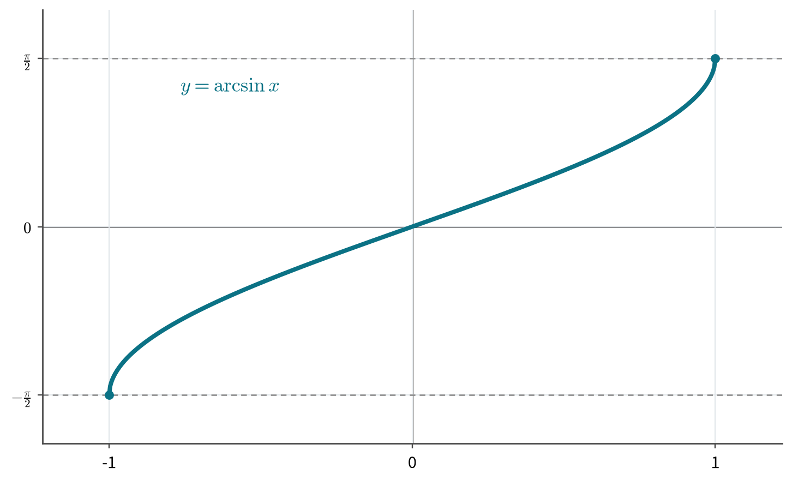

- 定义域 $[-1,1]$，值域 $\left[-\frac{\pi}{2},\frac{\pi}{2}\right]$。
- 图像从 $\left(-1,-\frac{\pi}{2}\right)$ 单调上升到 $\left(1,\frac{\pi}{2}\right)$，过原点，两端很陡。
- 奇函数：$\arcsin(-x)=-\arcsin x$，图像关于原点对称。
- 常用值：$\arcsin0=0$，$\arcsin\frac{1}{2}=\frac{\pi}{6}$，$\arcsin\frac{\sqrt2}{2}=\frac{\pi}{4}$，$\arcsin\frac{\sqrt3}{2}=\frac{\pi}{3}$，$\arcsin1=\frac{\pi}{2}$。

### 5.3 反余弦函数 $y=\arccos x$

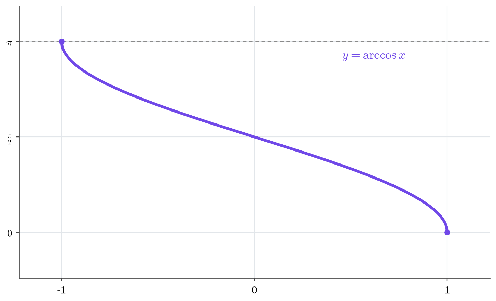

- 定义域 $[-1,1]$，值域 $[0,\pi]$。
- 图像从 $(-1,\pi)$ 单调下降到 $(1,0)$，过点 $\left(0,\frac{\pi}{2}\right)$。
- 单调减少，非奇非偶。
- $\arccos(-x)=\pi-\arccos x$，图像关于点 $\left(0,\frac{\pi}{2}\right)$ 对称。
- 常用值：$\arccos0=\frac{\pi}{2}$，$\arccos\frac{1}{2}=\frac{\pi}{3}$，$\arccos\frac{\sqrt2}{2}=\frac{\pi}{4}$，$\arccos\frac{\sqrt3}{2}=\frac{\pi}{6}$，$\arccos1=0$，$\arccos(-1)=\pi$。

### 5.4 反正切函数 $y=\arctan x$

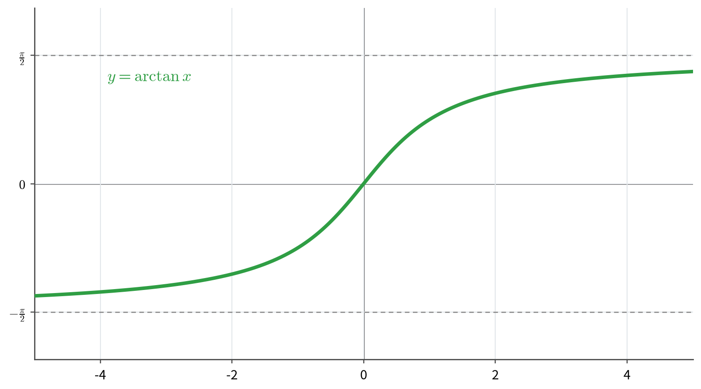

- 定义域 $\mathbb{R}$，值域 $\left(-\frac{\pi}{2},\frac{\pi}{2}\right)$。
- 奇函数，单调增加。
- 有两条水平渐近线 $y=\pm\frac{\pi}{2}$：当 $x\to\pm\infty$ 时 $\arctan x\to\pm\frac{\pi}{2}$，但永远达不到。
- 因此 $|\arctan x|<\frac{\pi}{2}$，即使 $x$ 很大，$\arctan x$ 也只是接近 $\frac{\pi}{2}$。
- 常用值：$\arctan0=0$，$\arctan\frac{\sqrt3}{3}=\frac{\pi}{6}$，$\arctan1=\frac{\pi}{4}$，$\arctan\sqrt3=\frac{\pi}{3}$。

### 5.5 反余切函数 $y=\operatorname{arccot} x$

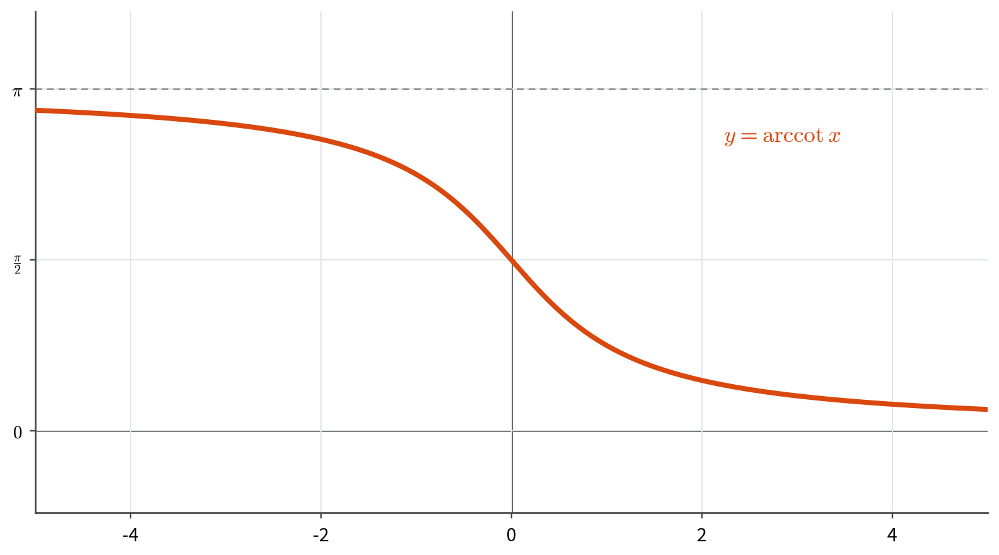

- 定义域 $\mathbb{R}$，值域 $(0,\pi)$。
- 单调减少，非奇非偶。
- 有两条水平渐近线：$y=0$（$x\to+\infty$）与 $y=\pi$（$x\to-\infty$）。
- $\operatorname{arccot}(-x)=\pi-\operatorname{arccot} x$，图像关于点 $\left(0,\frac{\pi}{2}\right)$ 对称。
- 常用值：$\operatorname{arccot}0=\frac{\pi}{2}$，$\operatorname{arccot}\frac{\sqrt3}{3}=\frac{\pi}{3}$，$\operatorname{arccot}1=\frac{\pi}{4}$，$\operatorname{arccot}\sqrt3=\frac{\pi}{6}$。
- 说明：不同教材对 $\operatorname{arccot}$ 的取值区间偶有差异，本笔记与同济教材一致，取 $(0,\pi)$。

### 5.6 反函数图像关于 $y=x$ 对称

一般地，若 $y=f(x)$ 有反函数，则 $y=f^{-1}(x)$ 的图像与 $y=f(x)$ 的图像关于直线 $y=x$ 对称。理由：点 $(a,b)$ 在 $f$ 的图像上，当且仅当 $f(a)=b$，当且仅当 $f^{-1}(b)=a$，当且仅当点 $(b,a)$ 在 $f^{-1}$ 的图像上。

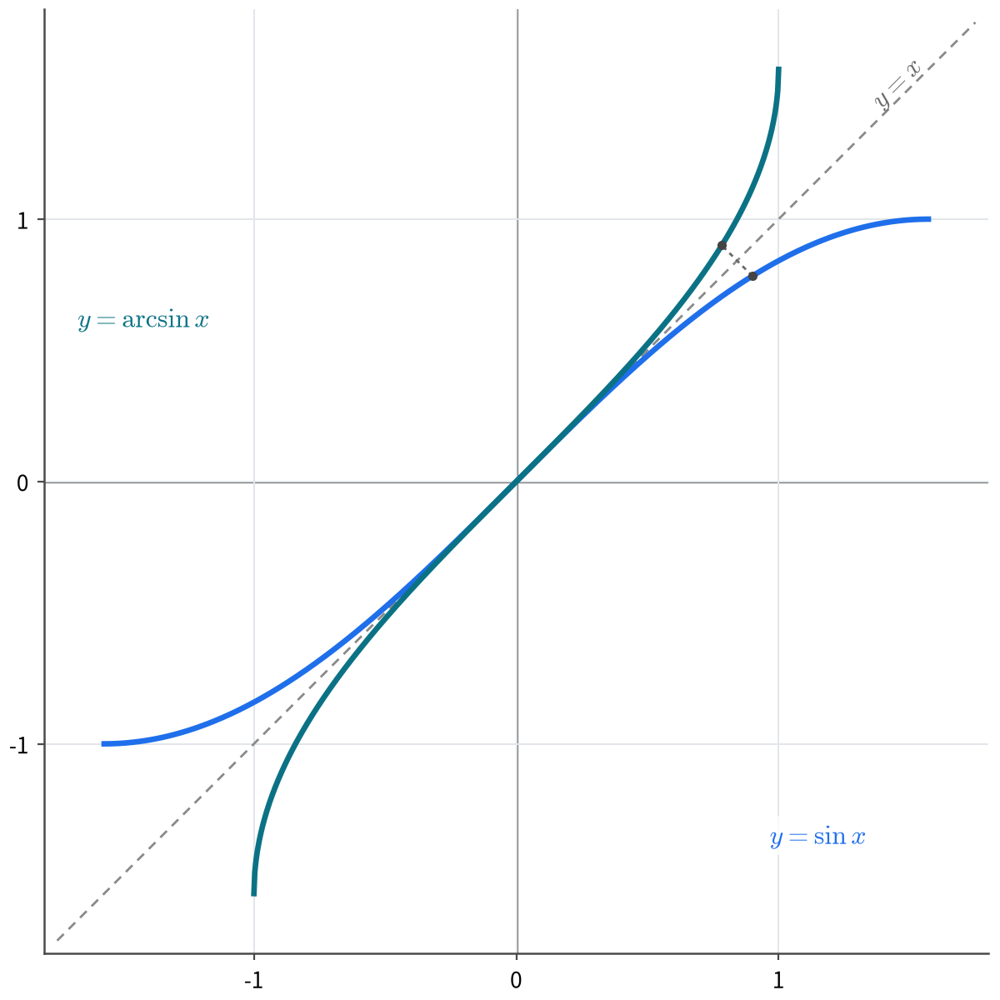

图中蓝线是 $y=\sin x$（$x\in\left[-\frac{\pi}{2},\frac{\pi}{2}\right]$），青线是 $y=\arcsin x$，两条曲线关于虚线 $y=x$ 互为镜像；小虚线连接了点 $(0.9,\sin0.9)$ 与它的镜像点 $(\sin0.9,0.9)$。其余三个反三角函数的图像，也都是把对应主值区间上的原函数曲线沿 $y=x$ 翻折得到的。

### 5.7 四个反三角函数的对照与关系式

| 函数 | 定义域 | 值域 | 奇偶性 | 单调性 | 渐近线 |
| --- | --- | --- | --- | --- | --- |
| $\arcsin x$ | $[-1,1]$ | $\left[-\frac{\pi}{2},\frac{\pi}{2}\right]$ | 奇 | 增 | 无 |
| $\arccos x$ | $[-1,1]$ | $[0,\pi]$ | 非奇非偶 | 减 | 无 |
| $\arctan x$ | $\mathbb{R}$ | $\left(-\frac{\pi}{2},\frac{\pi}{2}\right)$ | 奇 | 增 | $y=\pm\frac{\pi}{2}$ |
| $\operatorname{arccot} x$ | $\mathbb{R}$ | $(0,\pi)$ | 非奇非偶 | 减 | $y=0$，$y=\pi$ |

两个互补关系式：

$$\arcsin x+\arccos x=\frac{\pi}{2},\qquad x\in[-1,1];$$

$$\arctan x+\operatorname{arccot} x=\frac{\pi}{2},\qquad x\in\mathbb{R}.$$

以第一个为例：$\arccos x\in[0,\pi]$，所以 $\frac{\pi}{2}-\arccos x\in\left[-\frac{\pi}{2},\frac{\pi}{2}\right]$；又

$$\sin\left(\frac{\pi}{2}-\arccos x\right)=\cos(\arccos x)=x,$$

由反正弦的唯一性得 $\arcsin x=\frac{\pi}{2}-\arccos x$。第二个同理，利用 $\tan\left(\frac{\pi}{2}-\operatorname{arccot} x\right)=\cot(\operatorname{arccot} x)=x$。

这两个式子还可以当作“换算公式”：把一种反三角函数换成另一种。例如 $\arccos x=\frac{\pi}{2}-\arcsin x$，$\operatorname{arccot} x=\frac{\pi}{2}-\arctan x$。

| $x$ | $0$ | $\frac{1}{2}$ | $\frac{\sqrt2}{2}$ | $\frac{\sqrt3}{2}$ | $1$ |
| --- | --- | --- | --- | --- | --- |
| $\arcsin x$ | $0$ | $\frac{\pi}{6}$ | $\frac{\pi}{4}$ | $\frac{\pi}{3}$ | $\frac{\pi}{2}$ |
| $\arccos x$ | $\frac{\pi}{2}$ | $\frac{\pi}{3}$ | $\frac{\pi}{4}$ | $\frac{\pi}{6}$ | $0$ |

### 5.8 附：反正割与反余割

这两个函数在高等数学中一般不作重点，给出定义备查。

$$y=\operatorname{arcsec} x\iff \sec y=x,\quad y\in[0,\pi]\setminus\left\{\frac{\pi}{2}\right\};$$

$$y=\operatorname{arccsc} x\iff \csc y=x,\quad y\in\left[-\frac{\pi}{2},\frac{\pi}{2}\right]\setminus\{0\}.$$

两者的定义域都是 $|x|\ge1$，值域分别是 $[0,\pi]\setminus\left\{\frac{\pi}{2}\right\}$ 与 $\left[-\frac{\pi}{2},\frac{\pi}{2}\right]\setminus\{0\}$。与前面四个的关系是

$$\operatorname{arcsec} x=\arccos\frac{1}{x},\qquad \operatorname{arccsc} x=\arcsin\frac{1}{x},\qquad |x|\ge1.$$

---

## 六、回到单位圆：三角函数线

前面用坐标定义了六个函数，坐标是有正负的。现在回到单位圆，把每个函数值画成一条**有向线段**，函数值的正负和大小就同时出现在图上。

### 6.1 有向线段

规定了起点与终点的线段称为有向线段。规定：有向线段与坐标轴同向时取正值，反向时取负值；它的“数量”等于长度乘以符号。这样，有向线段的长度就可以直接表示一个带符号的数。

### 6.2 六条三角函数线

设角 $\alpha$ 的终边与单位圆交于点 $P$，过 $P$ 作 $x$ 轴的垂线，垂足为 $M$；记 $A(1,0)$、$B(0,1)$。

| 名称 | 线段 | 数量 |
| --- | --- | --- |
| 正弦线 | $MP$ | $\sin\alpha$ |
| 余弦线 | $OM$ | $\cos\alpha$ |
| 正切线 | $AT$ | $\tan\alpha$ |
| 余切线 | $BS$ | $\cot\alpha$ |
| 正割线 | $OQ$ | $\sec\alpha$ |
| 余割线 | $OR$ | $\csc\alpha$ |

其中各点的来历：

- $M$：$P$ 到 $x$ 轴的垂足；
- $T$：过 $A(1,0)$ 的切线 $x=1$ 与终边（或其反向延长线）的交点；
- $S$：过 $B(0,1)$ 的切线 $y=1$ 与终边（或其反向延长线）的交点；
- $Q$：过 $P$ 的切线与 $x$ 轴的交点；
- $R$：过 $P$ 的切线与 $y$ 轴的交点。

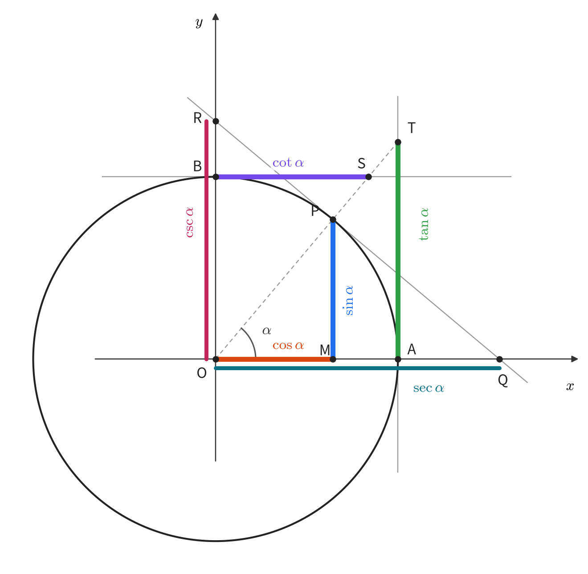

图中取 $\alpha$ 约为 $50^\circ$ 只是为了把六条线都画开；结论对任意角都成立。当 $\alpha$ 不在第一象限时，正切线、余切线的交点可能落在终边的反向延长线上，作图时先把终边反向延长即可。

### 6.3 为什么这些线段的长度就是函数值

- **正弦线、余弦线**：在直角三角形 $OMP$ 中，$OP=1$，$OM$ 与 $MP$ 分别就是 $P$ 的横、纵坐标，所以 $OM=\cos\alpha$，$MP=\sin\alpha$。
- **正切线**：在直角三角形 $OAT$ 中，$\angle AOT=\alpha$，$OA=1$，所以 $AT=OA\tan\alpha=\tan\alpha$。
- **余切线**：在直角三角形 $OBS$ 中，$\angle BOS=\frac{\pi}{2}-\alpha$，$OB=1$，所以 $BS=OB\tan\left(\frac{\pi}{2}-\alpha\right)=\cot\alpha$。
- **正割线**：$PQ$ 是过 $P$ 的切线，故 $OP\perp PQ$，直角三角形 $OPQ$ 中直角在 $P$，$\angle POQ=\alpha$，$OP=1$，于是 $\cos\alpha=\frac{OP}{OQ}=\frac{1}{OQ}$，即 $OQ=\sec\alpha$。
- **余割线**：同理，在直角三角形 $OPR$ 中 $\angle POR=\frac{\pi}{2}-\alpha$，$OP=1$，于是 $\sin\alpha=\cos\left(\frac{\pi}{2}-\alpha\right)=\frac{OP}{OR}=\frac{1}{OR}$，即 $OR=\csc\alpha$。

### 6.4 符号

有向线段的方向决定符号，这与 2.4 中“坐标的符号决定函数值符号”是同一件事：

- $MP$ 向上为正（$y>0$），向下为负；
- $OM$ 向右为正（$x>0$），向左为负；
- $AT$ 向上为正，向下为负；$BS$ 向右为正，向左为负；
- $OQ$ 向右为正，向左为负；$OR$ 向上为正，向下为负。

对照 2.4 的符号表，第二象限中 $MP>0$、$OM<0$、$AT<0$、$BS<0$，与 $\sin>0$、$\cos<0$、$\tan<0$、$\cot<0$ 一一对应。

### 6.5 从三角函数线读出性质

- **有界性**：$M$ 是 $P$ 在直径上的投影，$MP$ 是圆内一条弦的一半，$OM$ 不超过半径 $1$，所以 $|\sin\alpha|\le1$，$|\cos\alpha|\le1$。
- **正割、余割的范围**：$Q$、$R$ 都在单位圆外（或圆上），$|OQ|\ge1$，$|OR|\ge1$，所以 $|\sec\alpha|\ge1$，$|\csc\alpha|\ge1$，与 3.2 的结论一致。
- **单调性**：当 $\alpha$ 从 $0$ 增大到 $\frac{\pi}{2}$ 时，$MP$ 越来越长，$OM$ 越来越短，$AT$ 越来越长，于是 $\sin\alpha$ 递增、$\cos\alpha$ 递减、$\tan\alpha$ 递增。
- **渐近与无界**：当 $\alpha\to\frac{\pi}{2}$ 时，终边趋近 $y$ 轴，正切线的交点 $T$ 越跑越高，$AT$ 无界，这正是 $y=\tan x$ 在 $x=\frac{\pi}{2}$ 处有竖直渐近线的原因。
- **斜率的解释**：$\tan\alpha=\frac{y}{x}$ 就是终边所在直线的斜率，而正切线 $AT$ 恰好是这条直线在 $x=1$ 处的高度；$\cot\alpha$ 则是斜率的倒数，对应它在 $y=1$ 处的水平截距。

### 6.6 说明

- 图中正割线、余割线分别与 $x$ 轴、$y$ 轴上的余弦线、正弦线重合，为了在图上区分，作图时沿轴向平移了少许；实际作图时它们分别落在两条坐标轴上。
- 当 $\alpha$ 在第二、三象限时，终边与切线 $x=1$ 的交点 $T$ 落在终边的反向延长线上，作图时要先把终边反向延长。
- 许多教材只要求掌握正弦线、余弦线、正切线三条；余切线、正割线、余割线是同一套作图方法的自然补充。
- 三角函数线把“定义、符号、大小、单调、渐近”压缩在一张图里，是理解六个函数最直观的工具。
